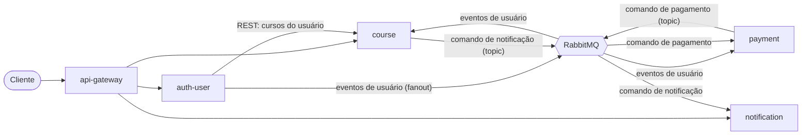

# Notification

## Sobre o projeto

Microsserviço de notificações da plataforma EAD. Consome comandos de notificação publicados por outros serviços (por exemplo, a confirmação de inscrição em um curso, enviada pelo `course`), grava as notificações no banco e as expõe por API para consulta e marcação como lidas.

Projeto de portfólio com foco em consumo de mensagens e organização em camadas. Há também uma versão do mesmo serviço em arquitetura hexagonal: [notification-hexagonal](https://github.com/LGui-santos/notification-hexagonal).

## Funcionalidades

- Consumo de comandos de notificação do RabbitMQ (exchange do tipo topic)
- Persistência das notificações com título, mensagem, data de criação e status (`CREATED` ou `READ`)
- Listagem paginada das notificações não lidas de um usuário
- Atualização do status de uma notificação (marcar como lida)

### Endpoints

Contexto da aplicação: `/ead-notification/`. Pelo gateway: `http://localhost:8080/ead-notification/...`

| Método | Rota | Acesso |
|---|---|---|
| GET | `/users/{userId}/notifications` | STUDENT |
| PUT | `/users/{userId}/notifications/{notificationId}` | STUDENT |

## Tecnologias utilizadas

- **Linguagem:** Java 21
- **Framework:** Spring Boot 4.0.6, Spring Web, Spring Data JPA
- **Banco de dados:** PostgreSQL
- **Segurança:** Spring Security, JWT (jjwt)
- **Microsserviços:** Spring Cloud 2025.1.2 (Eureka Client, Config Client)
- **Mensageria:** RabbitMQ (Spring AMQP)
- **Outros recursos:** Bean Validation, Actuator, Log4j2
- **Build:** Maven

## Como executar o projeto

**Pré-requisitos:** Java 21, PostgreSQL, RabbitMQ e os serviços de infraestrutura no ar.

1. Suba, nesta ordem, o [service-registry](https://github.com/LGui-santos/service-registry) e o [config-server](https://github.com/LGui-santos/config-server). As configurações deste serviço ficam em [ead-config-server-repo](https://github.com/LGui-santos/ead-config-server-repo) (`ead-notification-service-dev.yaml`).
2. Crie o banco de dados `ead-notification-v2` no PostgreSQL (a tabela é criada automaticamente).
3. Informe o endereço do seu RabbitMQ na propriedade `spring.rabbitmq.addresses` do arquivo de configuração.
4. Clone o repositório e use a branch `dev`:
   ```bash
   git clone https://github.com/LGui-santos/notification.git
   cd notification
   git checkout dev
   ./mvnw spring-boot:run
   ```
5. Para gerar notificações, suba também o [auth-user](https://github.com/LGui-santos/auth-user) e o [course](https://github.com/LGui-santos/course) e inscreva um aluno em um curso.

**Branches:** as versões mais atualizadas são `dev` (execução local) e `prod` (configuração por variáveis de ambiente, como `PORT` e `CONFIG_SERVER_URL`).

## Organização do projeto

```
src/main/java/com/ead/notification
├── controllers     # entrada das requisições REST
├── consumers       # consumo de comandos de notificação
├── services        # regras de negócio
├── repositories    # acesso a dados (Spring Data JPA)
├── models          # entidade de notificação
├── dtos            # objetos de entrada e comandos
├── enums           # status da notificação
└── configs         # segurança (JWT) e RabbitMQ
```

## O que este projeto demonstra

- Consumo de mensagens assíncronas com RabbitMQ
- Desacoplamento entre serviços por comandos publicados em mensageria
- Autenticação e autorização com Spring Security e JWT
- Organização do código em camadas
- Paginação com Spring Data JPA

## Melhorias futuras

- Corrigir o nome da fila no `@RabbitListener`, em que falta o fechamento `}` do placeholder da propriedade
- Ampliar os testes automatizados (hoje existe apenas o teste de carregamento do contexto)
- Documentar a API com OpenAPI/Swagger
- Permitir listar também as notificações já lidas

## Ecossistema EAD

Este projeto faz parte de uma plataforma de educação a distância (EAD) construída em microsserviços. Os serviços se descobrem pelo Eureka, buscam configuração no Config Server e se comunicam por REST e por mensageria (RabbitMQ).

| Serviço | Papel | Porta (dev) |
|---|---|---|
| [service-registry](https://github.com/LGui-santos/service-registry) | Service Discovery (Eureka Server) | 8761 |
| [config-server](https://github.com/LGui-santos/config-server) | Configuração centralizada (Spring Cloud Config) | 8888 |
| [ead-config-server-repo](https://github.com/LGui-santos/ead-config-server-repo) | Repositório de configurações dos serviços | - |
| [api-gateway](https://github.com/LGui-santos/api-gateway) | Ponto único de entrada | 8080 |
| [auth-user](https://github.com/LGui-santos/auth-user) | Usuários, autenticação e autorização | 8087 |
| [course](https://github.com/LGui-santos/course) | Cursos, módulos, lições e inscrições | 8082 |
| [payment](https://github.com/LGui-santos/payment) | Pagamentos com Stripe (em desenvolvimento) | 8086 |
| [notification](https://github.com/LGui-santos/notification) | Notificações aos usuários | 8084 |
| [notification-hexagonal](https://github.com/LGui-santos/notification-hexagonal) | Notificações em arquitetura hexagonal | 8084 |


